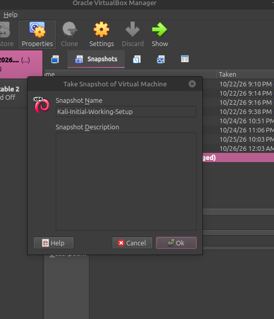

# Cybersecurity Lab Environment Setup

### Building a Virtual Cybersecurity Practice Environment with Kali Linux and Oracle VirtualBox


---

##  Project Overview

This repository documents my hands-on experience building a virtual cybersecurity laboratory using Oracle VirtualBox and Kali Linux.

The purpose of this project was to establish a dedicated environment for learning Linux administration, computer networking, cybersecurity fundamentals, and ethical hacking techniques.

I configured a custom NAT Network, imported Kali Linux 2026.2, assigned a static IPv4 address, established internet connectivity, configured host-to-guest file sharing, and created a virtual machine snapshot.

This environment provides a foundation for future cybersecurity labs and practical security exercises.

##  Project Objectives

- Install and configure Oracle VirtualBox.
- Import and configure a Kali Linux virtual machine.
- Create a custom VirtualBox NAT Network.
- Configure virtual network adapters.
- Assign a static IPv4 address.
- Configure DNS and verify internet connectivity.
- Enable clipboard sharing and drag-and-drop.
- Configure a shared folder between host and guest.
- Create a baseline virtual machine snapshot.
- Document the setup with screenshots and terminal commands.

---

##  Lab Architecture

The current laboratory consists of a Kali Linux host running a Kali Linux virtual machine through VirtualBox.

The guest VM connects to a dedicated NAT Network.

```text
                 HOST SYSTEM
                  Kali Linux
                      |
                      |
                VirtualBox 7.x
                      |
                      |
             Kali Linux Virtual Machine
                      |
                  Network eth0
                      |
                 NAT Network
                Kali-NATNetwork
                      |
                 10.0.0.0/24
                      |
                Kali VM Address
                  10.0.0.2
                      |
               Default Gateway
                  10.0.0.1
                      |
                Internet Access
```

The network can be extended with additional virtual machines for future authorised security-testing exercises.

---

##  Lab Specifications

| Component | Configuration |
|---|---|
| Host Operating System | Kali Linux |
| Hypervisor | Oracle VirtualBox 7.x |
| Guest Operating System | Kali Linux 2026.2 |
| Allocated RAM | 2048 MB |
| Network Type | NAT Network |
| Network Name | Kali-NATNetwork |
| IPv4 Network | 10.0.0.0/24 |
| DHCP | Disabled |
| Network Interface | eth0 |
| Static IP Address | 10.0.0.2/24 |
| Subnet Mask | 255.255.255.0 |
| Default Gateway | 10.0.0.1 |
| DNS Servers | 1.1.1.1, 8.8.8.8 |
| Shared Folder | downloads |
| Snapshot Name | Kali-Initial-Working-Setup |

---

#  Implementation Process

## 1. VirtualBox Installation

I installed Oracle VirtualBox on my Kali Linux host to provide the virtualization platform for my cybersecurity laboratory.

VirtualBox allows me to create, configure, and operate virtual machines independently of the host environment.

## 2. Creating the NAT Network

I created a custom NAT Network in VirtualBox to provide a dedicated private network for the lab.

Network configuration:

```text
Network Name: Kali-NATNetwork
IPv4 Prefix:  10.0.0.0/24
DHCP:         Disabled
```

Using a NAT Network allows connected virtual machines to communicate within the virtual network while supporting outbound connectivity.

**Evidence:** `screenshot/01_nat_network.png.png`

## 3. Importing Kali Linux

I downloaded and imported the prebuilt Kali Linux 2026.2 VirtualBox image.

The virtual machine was configured with 2048 MB of RAM.

## 4. Virtual Network Adapter Configuration

I configured the Kali virtual machine to use the custom NAT Network.

```text
Adapter 1:
Attached to: NAT Network
Network:     Kali-NATNetwork

Adapter 2:
Disabled
```

This configuration keeps the guest connected to the intended lab network.

**Evidence:** `screenshot/02_network_adapter.png`

## 5. Clipboard and Drag-and-Drop Configuration

I enabled bidirectional clipboard sharing and drag-and-drop in VirtualBox.

```text
Shared Clipboard: Bidirectional
Drag and Drop:    Bidirectional
```

These settings are intended to make file and text transfer between the host and guest more convenient.

**Evidence:** `screenshot/03_clipboard_dragdrop.png`

## 6. Shared Folder Configuration

I configured a shared folder to exchange files between the host operating system and the Kali virtual machine.

```text
Shared Folder Name: downloads
Host Directory:     $HOME/Downloads
Auto-mount:         Enabled
Writable:           Yes
```

The expected guest mount location is:

```bash
/media/sf_downloads
```

This provides convenient access to downloaded lab resources from inside the virtual machine.

**Evidence:** `screenshot/05_shared_folder.png`

## 7. Static IPv4 Configuration

After starting Kali Linux, I identified the active network interface:

```bash
ip -br addr
```

The active interface was `eth0`.

I then checked the NetworkManager connections:

```bash
nmcli connection show
```

The active connection was named `Wired connection 1`.

I assigned the static IPv4 address:

```bash
sudo nmcli connection modify "Wired connection 1" \
ipv4.method manual \
ipv4.addresses 10.0.0.2/24 \
ipv4.gateway 10.0.0.1
```

I configured the DNS servers:

```bash
sudo nmcli connection modify "Wired connection 1" \
ipv4.dns "1.1.1.1 8.8.8.8"
```

I restarted the network connection:

```bash
sudo nmcli connection down "Wired connection 1"
sudo nmcli connection up "Wired connection 1"
```

Finally, I verified the address:

```bash
ip -br addr
```

The expected configuration was displayed:

```text
eth0    UP    10.0.0.2/24
```

**Evidence:** `screenshot/4a_kali_ip.png`

## 8. Network and DNS Connectivity Testing

I tested external IP connectivity using:

```bash
ping -c 4 1.1.1.1
```

The test returned four successful replies with zero packet loss.

I also tested DNS resolution:

```bash
ping -c 4 google.com
```

After configuring the DNS servers, this test also completed successfully.

These tests confirmed that the virtual machine could reach an external IP address and resolve domain names.

**Evidence:** `screenshot/4b_kali_internet_test.png`

## 9. Creating a Baseline Snapshot

After completing the initial network configuration and connectivity tests, I created a VirtualBox snapshot.

```text
Snapshot Name: Kali-Initial-Working-Setup
```

The snapshot provides a recovery point before future experiments and configuration changes.

**Evidence:** 

---

#  Verification Results

| Verification | Command or Method | Result |
|---|---|---|
| Network interface | `ip -br addr` | eth0 active |
| Static IPv4 | `ip -br addr` | 10.0.0.2/24 |
| External connectivity | `ping -c 4 1.1.1.1` | Successful |
| DNS resolution | `ping -c 4 google.com` | Successful |
| Network connection | `nmcli connection show` | Verified |
| Shared folder | `/media/sf_downloads` | Configured |
| VM snapshot | VirtualBox Snapshots | Created |

---

#  Challenges and Troubleshooting

## DNS Resolution Failure

During the initial network test, the Kali virtual machine successfully reached an external IP address, but the domain-name test failed.

The error displayed was:

```text
Temporary failure in name resolution
```

This indicated that IP connectivity was available but DNS resolution was not working.

### Solution

I configured DNS servers using NetworkManager:

```bash
sudo nmcli connection modify "Wired connection 1" \
ipv4.dns "1.1.1.1 8.8.8.8"
```

I restarted the network connection and repeated the DNS test:

```bash
ping -c 4 google.com
```

The test succeeded after the DNS configuration was updated.

This troubleshooting experience helped me understand the difference between IP connectivity and DNS resolution.

---

#  Key Learning Outcomes

Through this project, I gained practical experience in:

**1. Virtualization**

Understanding how to create, import, and manage virtual machines using Oracle VirtualBox.

**2. Network Configuration**

Learning how NAT Networks connect virtual machines and provide a shared private network.

**3. Static IP Addressing**

Configuring IPv4 addresses, subnet masks, and gateways using NetworkManager.

**4. DNS Troubleshooting**

Understanding how DNS servers translate domain names into IP addresses and how incorrect DNS configuration affects connectivity.

**5. Host-to-Guest Integration**

Configuring shared folders, clipboard sharing, and drag-and-drop.

**6. Snapshot Management**

Creating a baseline recovery point before performing future security experiments.

---

#  Future Lab Improvements

I plan to expand this environment with additional virtual machines and practical exercises, including:

- Adding a deliberately vulnerable target machine.
- Practicing network discovery and port scanning.
- Learning packet analysis using Wireshark.
- Exploring vulnerability assessment tools.
- Practicing web application security in an authorized environment.
- Documenting future cybersecurity projects and findings.

---

#  Security and Ethical Use

This laboratory is intended for education and authorized cybersecurity testing.

All reconnaissance, scanning, vulnerability assessment, and penetration-testing activities will be performed only against systems that I own or have explicit permission to test.

---

#  Tools and Resources

- [Kali Linux](https://www.kali.org/get-kali/)
- [Oracle VirtualBox](https://www.virtualbox.org/wiki/Downloads)
- [7-Zip](https://www.7-zip.org/)

---

#  Author

**Aylia Zulfiqar**

Cybersecurity Student | Ethical Hacking and Network Security Enthusiast

GitHub: [@ayliazulfiqar](https://github.com/ayliazulfiqar)

---

##  Project Information

| Field | Details |
|---|---|
| Project | Cybersecurity Lab Environment Setup |
| Week | 01 |
| Module | Project Module 1 |
| Main Focus | Virtualization and Networking |
| Platform | Kali Linux and VirtualBox |
| Project Status | Initial Setup Completed |

---

*This repository represents my practical learning journey in building a virtual cybersecurity environment. I will continue updating it as I develop new skills and complete additional cybersecurity exercises.*
